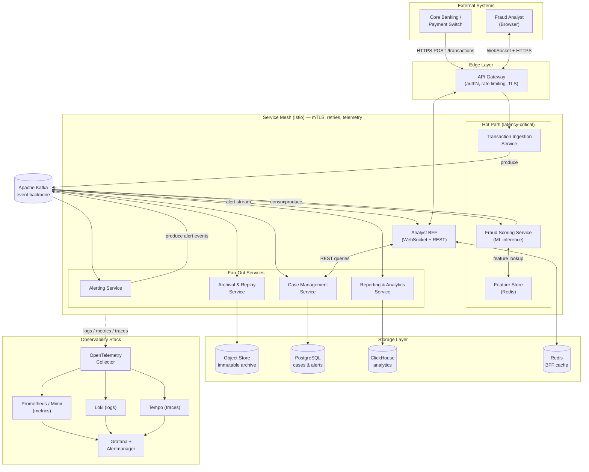
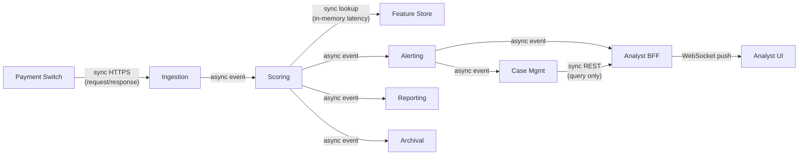
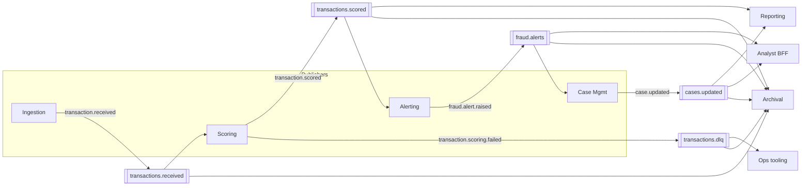
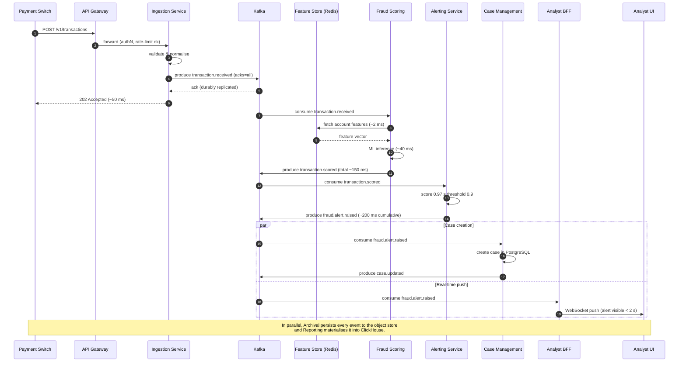
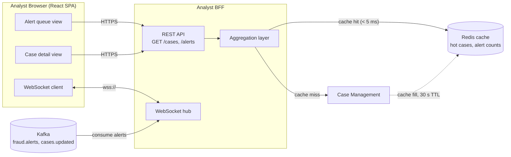
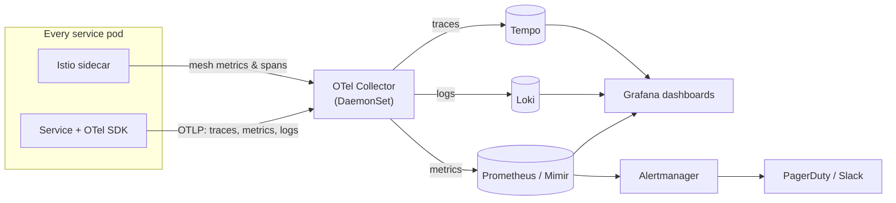
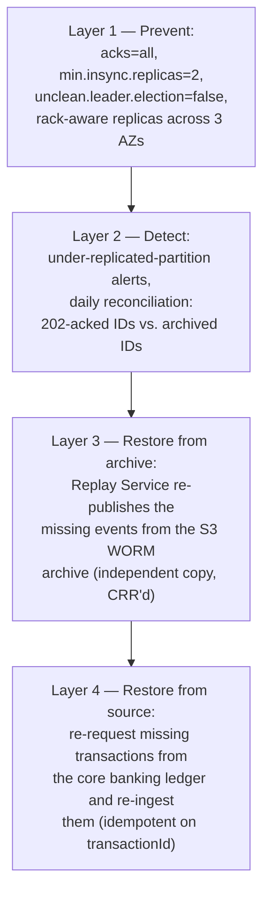
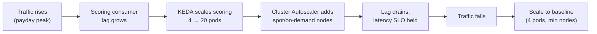

# Real-Time Financial Fraud Detection — Solution Architecture Report

## Table of Contents

1. [Problem Statement & Requirements Analysis](#1-problem-statement--requirements-analysis)
2. [Solution Overview & Architecture Diagram](#2-solution-overview--architecture-diagram)
3. [Functional Decomposition — Core Microservices](#3-functional-decomposition--core-microservices)
4. [Event-Driven Communication Design](#4-event-driven-communication-design)
5. [End-to-End Transaction Flow](#5-end-to-end-transaction-flow)
6. [Frontend Architecture](#6-frontend-architecture)
7. [Observability Design](#7-observability-design)
8. [Resilience & Failure Modes](#8-resilience--failure-modes)
9. [Scalability Strategy](#9-scalability-strategy)
10. [Proposed Technology Stack](#10-proposed-technology-stack)
11. [Deployment Considerations](#11-deployment-considerations)
12. [Proactive Operability for Exceptional Load](#12-proactive-operability-for-exceptional-load)
13. [Critical Evaluation & Trade-Offs](#13-critical-evaluation--trade-offs)

---

## 1. Problem Statement & Requirements Analysis

### 1.1 Business Problem

The bank's fraud detection system is batch-driven: transactions are analysed hours after
they occur, which means fraudulent activity is detected too late to block it, and the bank
will shortly be non-compliant with incoming real-time detection regulation. The business
needs fraud decisions **while the transaction is in flight**, an auditable record of every
decision, and a workflow that puts high-confidence fraud in front of human analysts
immediately.

### 1.2 Decomposition into Technical Objectives

| # | Business requirement | Technical objective |
|---|---------------------|---------------------|
| R1 | Real-time analysis of transactions | Streaming (not batch) pipeline; p99 end-to-end scoring latency budget of **500 ms** from ingestion to classification |
| R2 | Transactions must be captured & replayable for compliance | Durable, append-only event log with long-term immutable archive; deterministic replay tooling |
| R3 | Peak volume of 1,000 transactions/second | Horizontally scalable ingestion and scoring; partitioned messaging; load-tested to ≥ 2,000 TPS (2× headroom) |
| R4 | Elastic scaling without paying for peak 24/7 | Autoscaling on demand signals (CPU, consumer lag); scale-to-baseline during quiet periods |
| R5 | Real-time alerting via an analyst frontend | Push-based delivery (WebSocket/SSE) of high-confidence fraud alerts; alert visible to analysts within **2 s** of classification |
| R6 | Observability & alerting for operations | Unified logs, metrics, and traces with correlation; SLO-based alerting |

### 1.3 Key Architectural Drivers

- **Latency:** the 500 ms scoring budget rules out request/response chains through many
  synchronous hops; it pushes us towards an event-streaming backbone.
- **Durability & auditability:** regulators require that we can prove *what* the system saw
  and *what* it decided — the event log is the system of record, not a side effect.
- **Burstiness:** card traffic is spiky (paydays, Black Friday). Elasticity is a first-class
  requirement, not an optimisation.
- **Blast-radius control:** a failure in reporting must never block payment scoring. Loose
  coupling between the hot path and everything else is mandatory.

---

## 2. Solution Overview & Architecture Diagram

The solution is an **event-driven microservices architecture** built around a partitioned,
replicated event log (Apache Kafka). Transactions enter through a thin, stateless ingestion
tier, are scored by an ML inference service consuming from the log, and results fan out to
alerting, case management, archival, and the analyst frontend. A service mesh provides
mTLS, traffic policy, and telemetry; an observability stack aggregates logs, metrics, and
traces.

### 2.1 Solution Architecture Diagram



### 2.2 What Each Component Achieves

| Component | Purpose |
|-----------|---------|
| **API Gateway** | Single entry point; TLS termination, authentication, per-client rate limiting, request validation |
| **Transaction Ingestion Service** | Validates and normalises transactions; the only hot-path synchronous API; publishes to Kafka |
| **Kafka event backbone** | Durable, partitioned, replayable log — the system of record for every event |
| **Fraud Scoring Service** | Consumes transactions, enriches with features, runs ML inference, emits classification |
| **Feature Store (Redis)** | Low-latency (< 5 ms) lookup of per-account aggregates used as model features |
| **Alerting Service** | Applies alert policy to classifications; emits high-confidence fraud alerts |
| **Case Management Service** | Persists alerts as analyst-workable cases; owns case lifecycle |
| **Reporting & Analytics Service** | Materialises events into an OLAP store for dashboards and compliance reporting |
| **Archival & Replay Service** | Streams every event to immutable object storage; drives compliance replays |
| **Analyst BFF** | Frontend-shaped API; aggregates case + alert data; pushes real-time alerts over WebSocket |
| **Service Mesh (Istio)** | mTLS between services, retries/timeouts/circuit breaking, L7 telemetry for free |
| **Observability stack** | Collection, storage, correlation, and alerting on logs, metrics, and traces |

---

## 3. Functional Decomposition — Core Microservices

The solution's overall requirements decompose into **seven functional units**, each owned by
a single microservice with one primary responsibility. Decomposition follows two rules:
(1) services on the latency-critical "hot path" do the minimum work possible, and
(2) each service owns its own data — no shared databases.

### 3.1 Service Catalogue: Function, Inputs, Outputs

| Service | Primary responsibility | Trigger | Inputs | Outputs |
|---------|------------------------|---------|--------|---------|
| **Transaction Ingestion** | Accept, validate, and normalise incoming transactions | HTTP `POST /v1/transactions` from the payment switch | Raw transaction JSON | `transaction.received` event; `202 Accepted` to caller |
| **Fraud Scoring** | Classify each transaction with the ML model | `transaction.received` event | Transaction event + features from feature store | `transaction.scored` event (score, label, model version) |
| **Alerting** | Decide which classifications warrant analyst attention | `transaction.scored` event | Scored event + alert policy (thresholds) | `fraud.alert.raised` event |
| **Case Management** | Persist and manage the lifecycle of fraud cases | `fraud.alert.raised` event; analyst REST actions via BFF | Alert events, analyst decisions | Case records (PostgreSQL); `case.updated` event |
| **Reporting & Analytics** | Compliance reporting, dashboards, model-performance analytics | `transaction.scored` and `case.updated` events | All scored/case events | OLAP tables; scheduled regulatory reports |
| **Archival & Replay** | Immutable capture of every event; replay for compliance / model retraining | All events on the backbone; replay requested via admin API | Event stream | Parquet files in object store; replayed events onto a `replay.*` topic |
| **Analyst BFF** | Serve the analyst frontend; aggregate and push data | WebSocket connect / REST calls from frontend; `fraud.alert.raised` event | Alert events, case queries | WebSocket pushes, REST responses |

### 3.2 Inter-Service Communication & Coupling



**Coupling decisions:**

- **Asynchronous by default.** Every service-to-service interaction that *produces or reacts
  to a business fact* goes through Kafka. Producers do not know who consumes; consumers can
  be added (e.g., a future sanctions-screening service) without touching producers. This is
  what keeps the hot path's blast radius small — if Reporting is down, scoring is unaffected.
- **Synchronous only where unavoidable.** Three interactions are synchronous, each
  deliberately:
  1. *Payment switch → Ingestion*: the upstream switch is an existing system that calls an
     HTTP API; we return `202 Accepted` the moment the event is durably written to Kafka,
     keeping the synchronous surface minimal.
  2. *Scoring → Feature Store*: feature lookup must complete inside the latency budget;
     an in-memory store called synchronously is simpler and faster than any async pattern.
  3. *BFF → Case Management*: analyst queries ("show me case 123") are naturally
     request/response; modelling them as events would add latency and complexity for no
     benefit. See §4.4 for the full justification of these deviations.
- **Schema contracts, not shared code.** Services share only versioned Avro schemas via a
  schema registry. No shared libraries containing business logic, no shared databases.
- **Temporal decoupling.** Because Kafka retains events, consumers can be down for minutes
  and catch up without data loss — essential for zero-data-loss compliance.

---

## 4. Event-Driven Communication Design

### 4.1 Messaging Backbone

**Apache Kafka** is the event backbone. It was selected because it simultaneously satisfies
three hard requirements with one component:

1. **Throughput & partitioning** — 1,000 TPS peak is comfortably within Kafka's range; the
   `transactions.received` topic is partitioned by `accountId` (ordering per account, which
   matters for stateful fraud features).
2. **Durability & replay (R2)** — Kafka is an append-only log with configurable retention
   and tiered storage; combined with the Archival service it provides compliant capture
   and deterministic replay.
3. **Fan-out** — multiple independent consumer groups (scoring, reporting, archival) read
   the same stream at their own pace.

### 4.2 Event Catalogue

| Event | Topic | Publisher | Consumers | When / why it fires |
|-------|-------|-----------|-----------|---------------------|
| `transaction.received` | `transactions.received` | Ingestion | Scoring, Archival | A transaction passed validation and was accepted — the authoritative "the bank saw this" fact |
| `transaction.scored` | `transactions.scored` | Scoring | Alerting, Reporting, Archival | Model inference completed — carries score, label, model version for auditability |
| `fraud.alert.raised` | `fraud.alerts` | Alerting | Case Management, BFF, Archival | Score exceeded the high-confidence fraud threshold — analysts must see it now |
| `case.updated` | `cases.updated` | Case Management | Reporting, Archival, BFF | An analyst actioned a case (confirmed/dismissed) — feeds reporting and model-feedback loops |
| `transaction.scoring.failed` | `transactions.dlq` | Scoring | Ops tooling, Archival | A transaction could not be scored after retries — nothing silently disappears |

### 4.3 Event Flow Diagram (every event type)



### 4.4 Event Schemas

Schemas are **Avro**, registered in a schema registry with `BACKWARD` compatibility
enforced, so consumers never break when producers evolve. Representative schemas (shown as
JSON for readability):

**`transaction.received` (v1)**

```json
{
  "eventId": "uuid",
  "eventType": "transaction.received",
  "eventVersion": 1,
  "occurredAt": "2026-10-16T05:12:03.421Z",
  "traceId": "w3c-trace-id",
  "payload": {
    "transactionId": "txn-9f8e7d6c",
    "accountId": "acct-1234",
    "counterpartyAccount": "acct-9876",
    "amount": { "value": "1250.00", "currency": "USD" },
    "channel": "CARD_PRESENT",
    "merchantCategoryCode": "5411",
    "geo": { "lat": 40.71, "lon": -74.0, "country": "US" },
    "deviceFingerprint": "sha256:...",
    "initiatedAt": "2026-10-16T05:12:03.389Z"
  }
}
```

**`transaction.scored` (v1)**

```json
{
  "eventId": "uuid",
  "eventType": "transaction.scored",
  "eventVersion": 1,
  "occurredAt": "2026-10-16T05:12:03.610Z",
  "traceId": "w3c-trace-id",
  "payload": {
    "transactionId": "txn-9f8e7d6c",
    "accountId": "acct-1234",
    "fraudScore": 0.97,
    "classification": "FRAUD_SUSPECTED",
    "modelId": "gbt-fraud-v12",
    "modelVersion": "12.3.1",
    "featuresSnapshotRef": "s3://features/txn-9f8e7d6c.json",
    "inferenceLatencyMs": 38
  }
}
```

**`fraud.alert.raised` (v1)**

```json
{
  "eventId": "uuid",
  "eventType": "fraud.alert.raised",
  "eventVersion": 1,
  "occurredAt": "2026-10-16T05:12:03.655Z",
  "traceId": "w3c-trace-id",
  "payload": {
    "alertId": "alert-5544",
    "transactionId": "txn-9f8e7d6c",
    "accountId": "acct-1234",
    "fraudScore": 0.97,
    "severity": "HIGH",
    "recommendedAction": "BLOCK_AND_REVIEW",
    "policyId": "alert-policy-v4"
  }
}
```

Design notes:

- Every event carries `traceId` (W3C Trace Context) so observability spans can be stitched
  across async hops (§7.3).
- `modelId`/`modelVersion`/`featuresSnapshotRef` on scored events make every decision
  **explainable and auditable** — a regulatory expectation for ML-driven decisions.
- `eventVersion` plus registry-enforced compatibility gives safe schema evolution.

### 4.5 Deviations from the Event-Driven Pattern (and why)

| Deviation | Why it is the right call |
|-----------|--------------------------|
| **Ingestion API is synchronous HTTP** | The payment switch expects an acknowledgement. We keep the contract tiny: validate → write to Kafka with `acks=all` → return `202`. The ack means "durably captured", not "processed", preserving async semantics downstream. |
| **Scoring → Feature Store is a synchronous read** | A 1–3 ms Redis lookup inside the scoring span is far simpler and faster than event-sourcing features into each scoring pod. Features are *updated* asynchronously by a stream job, so writes remain event-driven. |
| **BFF → Case Management REST queries** | Queries are not business facts; they have no other consumers and need immediate answers. Using request/response here avoids building a redundant materialised view inside the BFF. |
| **Analyst actions arrive via REST, then become events** | The analyst's click is accepted synchronously (good UX), after which Case Management publishes `case.updated` — the event-driven pattern resumes at the first business fact. |

---

## 5. End-to-End Transaction Flow

The sequence below traces a single fraudulent transaction from the payment switch to the
analyst's screen, with the latency budget annotated.



**Latency budget (p99):** ingestion ack ≤ 150 ms · scored event published ≤ 500 ms after
ingestion · alert on analyst screen ≤ 2 s after scoring.

---

## 6. Frontend Architecture

### 6.1 Pattern: SPA + Backend-for-Frontend

The analyst frontend is a **React single-page application** backed by a dedicated **BFF**.
The BFF exists because the frontend's needs (aggregated case views, push alerts, session
handling) do not match any single domain service, and we do not want the browser talking to
five services or Kafka directly.



### 6.2 Staying Responsive: Data-Fetching Strategy

- **Push for new data, pull for history.** New alerts are *pushed* over WebSocket the
  moment `fraud.alert.raised` is consumed — no polling, sub-second delivery, and no load
  spike from thousands of analysts refreshing. Historical queries (case lists, search) are
  normal paginated REST calls.
- **Read-through Redis cache** in the BFF for hot data (open-case list, alert counts,
  analyst assignments) with short TTLs (10–30 s) plus event-driven invalidation: when the
  BFF consumes `case.updated` it evicts that case's cache entry, so analysts never act on
  stale case state.
- **Cursor-based pagination** on all list endpoints (stable under constant inserts, unlike
  offset pagination).
- **Optimistic UI** for analyst actions: the UI updates immediately on "dismiss/confirm",
  reconciling if the BFF reports failure.
- **Graceful degradation:** if the WebSocket drops, the client falls back to 5 s polling of
  a cheap `GET /alerts?since=cursor` endpoint and resynchronises on reconnect, so a push
  outage degrades latency but never correctness.

### 6.3 Performance Optimisations

- HTTP/2 + gzip/brotli from the gateway; SPA assets on a CDN.
- BFF responses are *frontend-shaped* (one round trip per screen) — no client-side joins.
- WebSocket fan-out is partitioned by analyst team so each BFF pod holds a bounded number
  of connections; pods are horizontally scalable because connection state is rebuilt from
  Kafka on reconnect (no sticky sessions required beyond the live socket).

---

## 7. Observability Design

### 7.1 Collection Architecture

All services emit telemetry via **OpenTelemetry SDKs** to a per-node **OpenTelemetry
Collector** (DaemonSet), which fans out to specialised backends. The service mesh sidecars
contribute L7 metrics and spans without code changes.



- **Logs** are structured JSON to stdout, scraped by the collector, stored in Loki. Every
  log line carries `service`, `traceId`, `spanId`, `transactionId`.
- **Metrics** follow the RED method (Rate, Errors, Duration) per service plus domain
  metrics; scraped/pushed into Mimir with exemplars enabled.
- **Traces** are sampled intelligently: 100% of error traces and all traces where
  `fraudScore ≥ threshold`; 10% tail-sampling otherwise, keeping cost proportional while
  guaranteeing every fraud decision is fully traceable.

### 7.2 Correlating Logs, Metrics, and Spans

Correlation is by **propagated W3C Trace Context**:

1. The API Gateway opens the root span; `traceId` flows through HTTP headers on sync hops.
2. On async hops, producers write `traceId` into **Kafka message headers and the event
   envelope**; consumers continue the trace as a *follows-from* span — one trace covers
   gateway → ingestion → Kafka → scoring → alerting → BFF push.
3. Every structured log line includes `traceId`/`spanId`, so Grafana jumps from a log line
   to the exact trace in Tempo in one click.
4. Metrics are linked via **exemplars**: latency histogram buckets carry sample `traceId`s,
   so an engineer looking at a p99 spike can open a representative trace immediately.
5. `transactionId` is a secondary business correlation key across all three signals,
   enabling "show me everything about txn-9f8e7d6c" during audits.

### 7.3 Key Metrics (the four that matter most)

| # | Metric | Why it is critical | Alert condition |
|---|--------|--------------------|-----------------|
| 1 | **Transaction throughput (TPS)** — counter of transactions processed per second, measured at three stages: accepted by Ingestion, consumed by Scoring, and `transaction.scored` published | Directly verifies the 1,000 TPS peak requirement (R3) and capacity headroom; a *divergence* between stage rates (e.g., ingested TPS ≫ scored TPS) is the earliest signal that the pipeline is falling behind; sudden drops indicate upstream outage or ingestion failure | Scored TPS < 90% of ingested TPS for 5 min → page; ingested TPS drops > 50% vs. 15-min baseline → page; sustained TPS > 80% of load-tested capacity → capacity-planning ticket |
| 2 | **End-to-end scoring latency** — histogram from `transaction.received` publish to `transaction.scored` publish | Directly measures the real-time compliance requirement (R1) | p99 > 500 ms for 5 min → page |
| 3 | **Scoring consumer lag** — Kafka lag on the scoring consumer group | Leading indicator: lag grows *before* latency SLOs breach; it is the autoscaling signal | lag > 5,000 msgs or growing 2 min continuously → page |
| 4 | **Ingestion availability/error rate** — ratio of non-5xx responses on `POST /v1/transactions` | If ingestion fails, transactions are invisible to fraud detection — the worst failure mode | error rate > 0.1% over 5 min → page |

Throughput, lag, and latency are deliberately monitored **together**: throughput tells us
how much work is arriving, lag tells us whether we are keeping up, and latency tells us
whether we are keeping up *fast enough*. Per-service request-rate (RED) metrics break
aggregate TPS down per microservice, so a throughput regression can be localised in one
dashboard.

Supporting metrics: model inference latency, alert-delivery latency (scored → WebSocket
push), DLQ depth (> 0 → ticket, rapid growth → page), feature-store hit rate, fraud-score
distribution drift (model health), Kafka under-replicated partitions, per-partition
throughput (detects key skew).

### 7.4 Service Level Objectives

All SLOs are specific, measurable from the metrics above, over a 30-day rolling window:

| SLO | Target |
|-----|--------|
| `POST /v1/transactions` requests return `202` in **< 150 ms** | 99.9% |
| During any 1-minute window with offered load ≤ 1,000 TPS, the scored-transaction rate is ≥ 99% of the ingested-transaction rate | 99.9% of windows |
| Transactions receive a `transaction.scored` event within **500 ms** of `transaction.received` | 99.9% |
| High-confidence fraud alerts are pushed to a connected analyst session within **2 s** of `transaction.scored` | 99.0% |
| `GET` calls to the Analyst BFF complete in **< 200 ms** | 99.0% |
| Transactions acknowledged with `202` are never lost (appear in archive) | 100% (zero-loss; measured by reconciliation job) |

Error budgets derived from these SLOs gate releases: if the scoring-latency budget is
exhausted, feature work pauses in favour of reliability work.

---

## 8. Resilience & Failure Modes

### 8.1 Single Points of Failure and Mitigations

| Potential SPOF | Mitigation |
|----------------|------------|
| **Kafka cluster** | Minimum 3 brokers across 3 availability zones; replication factor 3, `min.insync.replicas=2`; rack-aware placement. Managed service (e.g., MSK) removes broker-ops risk. |
| **API Gateway / Ingestion** | Stateless; ≥ 3 replicas behind a multi-AZ load balancer; health-checked; horizontal autoscaling. |
| **Fraud Scoring service** | Stateless consumers in a consumer group; a pod loss triggers partition rebalance, and uncommitted offsets are re-consumed (at-least-once). Model artefacts are baked into images/served from replicated model registry. |
| **Feature Store (Redis)** | Redis Cluster with replicas and multi-AZ; on total feature-store failure, scoring degrades to a reduced-feature model variant rather than failing closed (documented, risk-accepted fallback). |
| **PostgreSQL (cases)** | Primary + synchronous standby in another AZ; automated failover; PITR backups. |
| **Schema Registry** | Clustered; schemas also cached client-side, so a registry outage does not stop steady-state traffic. |
| **Observability stack** | Deliberately *not* on the hot path — its failure never blocks transactions; collectors buffer locally during backend outages. |
| **Single region** | The remaining design-level SPOF. Mitigation path: Kafka cross-region replication (MirrorMaker 2) + warm standby region; accepted initially as a cost/complexity trade-off with documented RTO/RPO. |

### 8.2 Data-Loss Scenarios and Recovery

The anchor guarantee: **once Ingestion returns `202`, the transaction is replicated to at
least 2 brokers** (`acks=all`, `min.insync.replicas=2`). Everything downstream is
recoverable by replay.

| Scenario | Handling | Recovery |
|----------|----------|----------|
| Ingestion pod dies mid-request | Caller receives no `202` → payment switch retries; idempotency key (`transactionId`) deduplicates | No loss; duplicates suppressed |
| Scoring pod dies mid-batch | Offsets uncommitted → messages redelivered to another pod (at-least-once; scored event is idempotent on `transactionId`) | Automatic |
| Poison message / model error | After 3 retries, event routed to `transactions.dlq` with error context; DLQ depth alerting | Ops replays DLQ after fix — nothing silently dropped |
| Kafka broker loss | Replicated partitions elect new leaders; producers/consumers reconnect transparently | Automatic |
| Downstream store corruption (Postgres/ClickHouse) | They are **materialised views over the event log** | Restore from backup, then replay events from Kafka/archive to rebuild state |
| Replication failure permanently loses events from Kafka (e.g., simultaneous multi-broker loss, `unclean` leader election) | Detected by under-replicated-partition alerts and the daily reconciliation job | See §8.2.1 — recovery from the archive copy or, failing that, from the upstream system of record |
| Catastrophic Kafka data loss | Archive in object storage (11-nines durability, versioned, object-lock/WORM) is the compliance copy | Replay Service re-publishes archived events to rebuild topics |
| Reconciliation | Daily job compares `202`-acknowledged count vs. archived event count | Discrepancy = SLO breach, triggers investigation |

#### 8.2.1 Recovering Events Permanently Lost to Replication Failure

Re-consuming uncommitted messages and the DLQ only cover *processing* failures — they
assume the event still exists in Kafka. If replication itself fails (e.g., both in-sync
replicas are lost before a follower catches up, or an unclean leader election truncates a
partition), events can be **permanently gone from the broker**. The design handles this
with defence in depth across four layers:



1. **Prevent (make loss improbable):** producers use `acks=all` with
   `min.insync.replicas=2` and `unclean.leader.election.enable=false`, with replicas
   spread rack-aware across three AZs — an acknowledged event survives any single broker
   or AZ failure, and a stale replica can never be elected leader and silently truncate
   history.
2. **Detect (make loss visible):** under-replicated-partition metrics page operations
   while redundancy is degraded, and a **daily reconciliation job compares the set of
   `transactionId`s acknowledged with `202` (logged independently by Ingestion) against
   the set present in the object-store archive**. Any gap is enumerable — we know exactly
   *which* events are missing, not just that a count differs.
3. **Restore from the archive (independent copy):** the Archival service maintains a copy
   of every event in object storage (11-nines durability, versioned, WORM-locked,
   cross-region replicated). Because this copy lives outside Kafka on independent
   infrastructure, a Kafka replication failure cannot touch it. The Replay Service
   re-publishes the missing events onto the original or `replay.*` topics, and downstream
   consumers (all idempotent on `transactionId`) rebuild their state.
4. **Restore from the system of record (last resort):** in the worst window — an event is
   lost *after* the `202` ack but *before* the Archival consumer read it — no copy exists
   inside this system. The transactions themselves, however, originate in the **core
   banking ledger, which is the bank's authoritative system of record** and retains every
   transaction independently. The reconciliation gap list drives a re-ingestion job that
   pulls the missing transactions from the ledger and re-submits them through Ingestion
   with their original `transactionId`s; idempotent consumers make the re-run safe.
   Derived events (`transaction.scored`, alerts) are then **regenerated deterministically**
   by re-scoring — nothing derived needs to be backed up, only recomputed.

The net guarantee: a replication failure can delay fraud analysis for the affected
events, but it cannot cause a transaction to permanently escape capture, scoring, or the
compliance archive.

### 8.3 Replayability (Compliance Requirement R2)

- Kafka retains hot events for 7 days (tiered storage extends cheaply).
- The Archival service writes every event as Parquet to object storage, partitioned by
  date/topic, with **object lock (WORM)** for the regulated retention period (7 years).
- The Replay service can re-publish any time-slice onto `replay.*` topics, letting us
  re-run a historical day through a new model version — for audits, incident
  reconstruction, or model back-testing — without touching live topics.

---

## 9. Scalability Strategy

Every tier of the solution scales **horizontally** — demand is absorbed by adding
identical units (pods, partitions, consumers, shards, brokers) rather than by growing a
single bigger box. This works because the design keeps state out of the compute tier:
services are stateless, all durable state lives in Kafka, Redis, PostgreSQL, ClickHouse,
and object storage, and work is partitioned by `accountId` so any unit can pick up any
partition's share. The subsections below detail the mechanism, the scaling signal, and
the practical limit for each tier.

### 9.1 Individual Microservices

- All services are **stateless containers on Kubernetes** (state lives in Kafka, Redis,
  Postgres, object storage), so scaling is adding pods — there is no session state to
  migrate, no leader to elect, and no warm-up dependency, which keeps scale-out time to
  pod-start time (seconds).
- **HTTP-facing services** (Ingestion, BFF) scale via HPA on CPU + request-rate custom
  metrics, behind load balancers: doubling pods doubles request-handling capacity
  near-linearly because requests are independent. Ingestion at 1,000 TPS needs only a
  handful of pods (each pod validates + produces, both cheap operations), so there is
  ample headroom before any architectural limit.
- **Event consumers** (Scoring, Alerting, Reporting, Archival) scale via **KEDA on Kafka
  consumer lag** — the most honest demand signal for a streaming system. Lag rises → pods
  added → Kafka's group protocol automatically rebalances partitions across the new pods,
  each taking an equal share of the stream → lag drains → scale back to baseline. This
  directly delivers R4: peak capacity only when there is peak load.
- **Scaling limit and how we stay ahead of it:** a consumer group cannot usefully exceed
  one consumer per partition, so partition count is the ceiling on consumer parallelism.
  `transactions.received` starts with 24 partitions (≥ 2× the pods needed at 2,000 TPS),
  so consumer scaling never waits on repartitioning; partition count is reviewed when
  sustained throughput passes 50% of load-tested capacity.
- **Independent scaling per service:** because services share nothing but topics, Scoring
  can run 20 pods while Case Management runs 2 — capacity is bought exactly where demand
  exists, not cluster-wide.

### 9.2 Analytic Workloads

- Analytics are **physically separated from the hot path**: Reporting consumes the same
  topics into **ClickHouse**, so a 10-way regulatory query scan cannot slow scoring. The
  two workloads scale on independent axes and never compete for the same resources.
- **Ingest scales with the stream:** the Reporting consumer group scales horizontally on
  lag exactly like Scoring (§9.1) — analytics ingest keeps pace with transaction volume
  by adding consumer pods, up to the partition count.
- **Query capacity scales with readers:** ClickHouse scales reads by adding replicas
  (each replica serves queries independently) and writes by adding shards (data is
  distributed, so each shard indexes a fraction of the stream); heavy end-of-year
  compliance queries run on dedicated replica nodes added for the occasion and removed
  afterwards.
- **Batch analytics scale elastically to near-zero cost:** model training/back-testing
  reads **archived Parquet from object storage** via Spark on elastic (spot) compute —
  Spark parallelism grows with executor count against partitioned Parquet, giving
  effectively unbounded horizontal scale with zero impact on production, and it costs
  nothing when idle.

### 9.3 Event Messaging

- Kafka scales horizontally on **two independent axes**: *brokers* (storage + network
  capacity — partitions redistribute across new brokers) and *partitions* (parallelism —
  more partitions allow more concurrent consumers per group). At 1,000–2,000 TPS with
  ~1 KB events (~2 MB/s) a 3-broker cluster has an order of magnitude of headroom, so
  scaling here is about growth, not survival.
- **Consumer-side scaling is where the real elasticity lives:** each consumer group
  divides partitions among its members, so adding consumers (KEDA, §9.1) raises
  consumption throughput linearly up to the partition count — and each group (scoring,
  reporting, archival) scales independently against the same stream.
- **Tiered storage** keeps brokers small while retaining long replay windows.
- Partition keys (`accountId`) preserve per-account ordering while spreading load evenly;
  key skew is monitored via per-partition throughput metrics.
- Managed Kafka (MSK) re-balances and scales storage without downtime.

#### 9.3.1 Horizontal Consumer Scaling and Delivery Semantics

Scaling consumers horizontally is not free of semantic consequences, and the design is
explicit about them:

- **Rebalances create redelivery windows.** When KEDA adds or removes a consumer pod, the
  group rebalances partition assignments. Any messages a departing consumer had processed
  but **not yet committed offsets for are redelivered** to the consumer that inherits the
  partition. The more aggressively we scale in and out, the more often this happens —
  horizontal consumer scaling therefore makes duplicate delivery an *expected, routine*
  event, not an edge case.
- **Why we do not rely on exactly-once delivery.** Kafka offers exactly-once semantics
  (idempotent producers + transactions), but it only holds **within** the Kafka
  read-process-write loop. Our consumers produce *side effects outside Kafka* — Redis
  writes, PostgreSQL rows, WebSocket pushes, S3 objects — which Kafka transactions cannot
  cover, so true end-to-end exactly-once is unattainable here regardless of
  configuration. Kafka transactions would also add latency (transactional commits,
  `read_committed` isolation) and, critically, **sit awkwardly with elastic scaling**:
  frequent rebalances force transaction aborts and fencing, so the delivery guarantee
  would be weakest precisely when the system scales most.
- **The chosen model: at-least-once + idempotent consumers.** Every consumer treats
  `transactionId`/`eventId` as an idempotency key: Scoring re-emitting a duplicate
  `transaction.scored` is harmless (same key, same content), Case Management upserts by
  `alertId`, the Archival service writes deterministic object keys so duplicates
  overwrite identical content. Under this model, **horizontal scaling is semantically
  free**: pods can join and leave the group at any rate, redeliveries are absorbed by
  idempotency, and no cross-service transaction coordinator limits throughput.
- **Ordering under scale-out:** partition assignment guarantees each partition has exactly
  one owning consumer at a time, so per-account ordering (our partition key) is preserved
  no matter how many consumers the group scales to. Only cross-account ordering is
  unordered — which the fraud domain does not require.

### 9.4 Elasticity & Cost Control (R4)



Baseline capacity is sized for median load (~200 TPS); burst capacity uses spot instances
where interruption-tolerant (scoring consumers, analytics), on-demand elsewhere.

---

## 10. Proposed Technology Stack

| Layer | Technology | Justification |
|-------|-----------|----------------|
| Container platform | **Kubernetes (managed — e.g., EKS)** | Industry-standard orchestration; HPA/KEDA autoscaling; multi-AZ; huge operational talent pool |
| Service mesh | **Istio** | mTLS everywhere (regulatory expectation), retries/timeouts/circuit-breaking as config, free L7 telemetry; cost of operating it is justified at this service count (§13) |
| Event backbone | **Apache Kafka (managed — MSK)** | Durable replayable log satisfies R2 and R3 in one component; partitioned consumer scaling; tiered storage for retention. Chosen over RabbitMQ (no replay) and Kinesis (weaker ecosystem/portability) |
| Schema management | **Confluent Schema Registry (Avro)** | Enforced backward compatibility — contract safety across independently deployed services |
| Hot-path services (Ingestion, Alerting, BFF) | **Go** | Low, predictable latency, small footprint, first-class concurrency; fast cold-start aids elastic scaling |
| Scoring service | **Python + ONNX Runtime / Triton Inference Server** | Native ML ecosystem; ONNX decouples training framework from serving; Triton gives batching + GPU option if models grow |
| Feature store | **Redis (cluster mode)** | Sub-millisecond reads inside the 500 ms budget; mature HA story. Features updated by a Kafka Streams job |
| Case store | **PostgreSQL (managed, multi-AZ)** | ACID for case lifecycle (analyst decisions are legally significant); mature backup/PITR |
| Analytics store | **ClickHouse** | Columnar OLAP built for high-ingest, large-scan workloads; isolates analytic load from OLTP |
| Immutable archive | **S3-compatible object store + Parquet + Object Lock** | 11-nines durability, WORM compliance retention, cheap at 7-year horizons, directly queryable by Spark/Athena |
| BFF cache | **Redis** | Same operational muscle as the feature store; TTL + event-driven invalidation |
| Frontend | **React + TypeScript, WebSocket** | Mature ecosystem; typed contracts with the BFF; push-based real-time UX |
| Observability | **OpenTelemetry + Prometheus/Mimir + Loki + Tempo + Grafana** | Vendor-neutral instrumentation (no lock-in), one pane of glass, native exemplar/trace correlation; OSS cost profile at bank scale |
| CI/CD & progressive delivery | **GitLab CI/ArgoCD + Argo Rollouts** | GitOps auditability (regulators like declarative, reviewed change); canary deploys for the scoring model |
| IaC | **Terraform** | Reviewable, reproducible environments; drift detection |

---

## 11. Deployment Considerations

**Target: AWS** (the bank's existing cloud from the prior migration), composed of EKS, MSK,
ElastiCache, RDS/Aurora PostgreSQL, S3 (+ Object Lock), and CloudFront for SPA assets.

Adaptations to the provider's idiosyncrasies:

- **MSK quotas & scaling:** MSK scales broker storage automatically but broker *count*
  changes are slow — size partitions and brokers for 2× projected peak up front rather than
  relying on reactive broker scaling.
- **AZ-aware consumers:** cross-AZ data transfer is billed; use Kafka rack-aware fetch
  (`client.rack`) so consumers read from in-AZ replicas, materially cutting network cost at
  sustained throughput.
- **IAM-first security:** use IRSA (IAM Roles for Service Accounts) for all data-plane
  access (MSK, S3, RDS) — no static credentials anywhere.
- **Spot capacity:** scoring consumers and Spark analytics tolerate interruption (offsets
  replay) so they run on spot node groups; ingestion and stateful stores stay on-demand.
- **Regional strategy:** start single-region multi-AZ; the compliance archive replicates
  cross-region from day one (S3 CRR), so even before a warm-standby region exists, the
  regulated data survives a regional disaster.

---

## 12. Proactive Operability for Exceptional Load

Compliance audits and end-of-financial-year processing produce load profiles the system was
not shaped for (huge historical scans + elevated live traffic). Proactive measures:

1. **Workload isolation by construction** — audits hit ClickHouse replicas and the S3
   archive, never the hot path. The most important protection is architectural, not
   reactive.
2. **Pre-scaling runbooks tied to the calendar:** EOFY and audit windows are known —
   scheduled scaling policies raise baseline pods/nodes and pre-warm ClickHouse replicas
   ahead of time instead of relying on reactive autoscaling.
3. **Continuous load testing:** a synthetic-traffic environment is driven at 2× peak
   (2,000 TPS) on every release; regressions in the latency SLO block promotion.
4. **Backpressure & load shedding:** the gateway enforces per-client rate limits; if
   scoring lag exceeds safe bounds, alerting and reporting consumers deliberately deprioritise
   (they can catch up), preserving the scoring SLO.
5. **Chaos engineering:** regular game days kill brokers, scoring pods, and the feature
   store in staging to verify the mitigation table in §8 is real, not aspirational.
6. **Dedicated audit read paths:** auditors get read-only credentials to a *separate*
   ClickHouse replica set and Athena-over-S3, with their own resource quotas.
7. **Error-budget-based change freeze:** during declared high-risk windows (EOFY),
   deployment policy tightens automatically unless error budgets are healthy.

---

## 13. Critical Evaluation & Trade-Offs

An honest accounting of what this design costs, and why each cost is worth paying in a
financial-services context.

| Decision | Cost | Benefit / why worthwhile |
|----------|------|--------------------------|
| **Event-driven core (Kafka)** | Eventual consistency between services; harder local debugging; Kafka operational expertise required | Replayability is a *legal requirement*, and Kafka provides it natively. Decoupling bounds blast radius — in a bank, "reporting is 2 minutes behind" is acceptable; "payments scoring stopped because reporting is down" is not. |
| **At-least-once delivery + idempotent consumers** (vs. exactly-once) | Every consumer must handle duplicates (dedupe on `transactionId`) | Exactly-once semantics across heterogeneous stores is fragile and slow, and interacts badly with elastic consumer scaling (§9.3.1). Idempotency is simpler to reason about and audit — and auditability beats elegance in this domain. |
| **Microservices (7 services) vs. modular monolith** | Operational overhead: 7 deployables, mesh, registry, more sophisticated CI/CD | Independent scaling (scoring needs 10× the pods of case management), independent release cadence (model updates weekly, case mgmt quarterly), and failure isolation. The bank is already cloud-native, so the platform cost is amortised. |
| **Service mesh (Istio)** | Sidecar latency (~1 ms/hop), significant platform-team learning curve | Uniform mTLS satisfies encryption-in-transit expectations without per-team crypto code; circuit breaking and retries become policy, not code; mesh telemetry fills observability gaps. At fewer services, this would not pay off — at this scale and regulatory bar, it does. |
| **BFF layer** | One more service to own; risk of business logic leaking into it | Frontend-shaped responses keep the UI fast (one round trip per screen); the WebSocket hub needs *somewhere* to live; domain services stay clean of presentation concerns. Mitigate logic-leak via review guardrails: BFF aggregates, never decides. |
| **Synchronous feature lookup on the hot path** | Redis becomes latency-critical infrastructure | The alternative (feature state embedded in every scoring pod via changelog topics) is more resilient but much more complex. Redis Cluster + a documented degraded-model fallback is an acceptable, well-understood risk. |
| **Fail-open vs. fail-closed scoring** | If scoring is fully down, transactions proceed unscored (flagged for retroactive scoring on recovery) | Blocking **all** bank transactions because fraud scoring is down is a worse outcome (availability of payments is itself regulated). The DLQ + replay guarantees retroactive analysis of every missed transaction; the risk window is bounded and auditable. This is a *business* risk decision, documented and signed off — not an engineering default. |
| **Single region initially** | Regional outage halts live scoring (RTO hours, not minutes) | Full active-active doubles cost and complexity (cross-region Kafka is hard). The compliance archive is cross-region from day one, so no *data* is ever at risk — only availability. Revisit once the platform is stable; the design (replayable log) makes the later migration tractable. |
| **OSS observability stack vs. SaaS APM** | More self-managed components | Data residency/sovereignty simplicity, no per-GB vendor pricing at bank log volumes, and OpenTelemetry keeps the door open to SaaS later with zero re-instrumentation. |

### Summary

The architecture converts the bank's compliance deadline into a design anchored on one
idea: **the durable event log is the system of record**. Everything else — real-time
scoring, alerting, reporting, archival, replay, recovery, even scaling signals — derives
from it. The dominant trade-off accepted is eventual consistency and distributed-systems
operational complexity in exchange for latency, elasticity, auditability, and bounded
failure domains — a trade squarely aligned with how risk is weighed in financial services.
